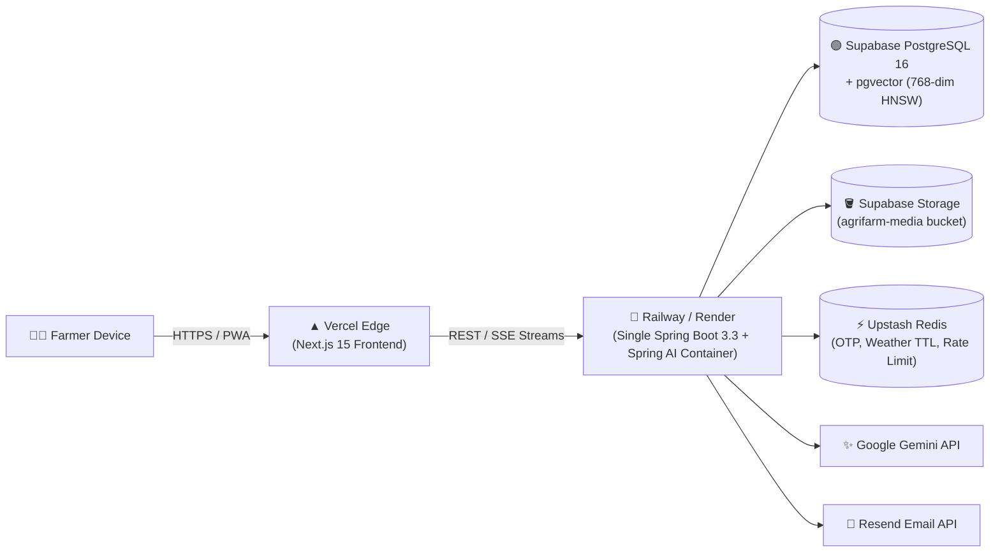

# 🚀 AgriFarmAssistant: Production Deployment Guide

> **Target Free-Tier Friendly Cloud Stack**:  
> - **Frontend (Next.js 15 PWA)**: Hosted on **Vercel** (Global Edge CDN)  
> - **Backend + Java Spring AI RAG (Spring Boot 3.3 / Java 21)**: Hosted on **Railway** or **Render** (Single Docker Container)  
> - **Database & Vector Store**: **Supabase** (PostgreSQL 16 + `pgvector` 768-dim HNSW index)  
> - **Media / Object Storage**: **Supabase Storage** (`agrifarm-media` bucket for MVP; optional **Cloudflare R2** upgrade later)  
> - **Cache, OTP & Rate Limiting**: **Upstash Redis** (Serverless)  
> - **Email OTP & Digests**: **Resend**

> [!NOTE]
> `docker/docker-compose.yml` is strictly for **local development** only. Any existing MongoDB configuration in `.env.example` or `agrifarm-backend/pom.xml` is legacy scaffolding and is migrated to **Supabase (PostgreSQL 16 + `pgvector`)** in Phase 2/3.

---

## 📋 Architecture & Resource Allocation



---

## Part 1: Supabase Database, `pgvector` & Storage Setup

1. Create a free project in the [Supabase Dashboard](https://supabase.com/dashboard).
2. Open **SQL Editor** and enable `pgvector`:
   ```sql
   CREATE EXTENSION IF NOT EXISTS vector;
   ```
3. Copy your **Transaction Pooler** JDBC connection string (`port 6543`) for Spring Boot runtime and your **Session/Direct** connection string (`port 5432`) for Flyway migrations.
4. Go to **Storage** $\to$ **New Bucket** $\to$ create `agrifarm-media` (private bucket, accessed via signed URLs; metadata URLs stored in the `media_history` table).
   - *Optional later upgrade:* You may swap to **Cloudflare R2** (10 GB free egress) for high-volume media; do **not** run self-hosted MinIO in production.

---

## Part 2: Railway / Render Single-Container Backend Deployment

All 20 backend modules **and** the 100% Java Spring AI RAG ETL pipeline (`modules/ai/rag/ingestion/`) run inside **one** Spring Boot 3.3 (Java 21) container. There is no separate Python ETL container.

### Step 1: Configure Spring Boot JVM for Free-Tier Memory Limits

> [!IMPORTANT]
> Free/starter tiers on Railway and Render provide 512 MB to 1 GB of RAM. The JVM must be instructed not to exceed the container memory limit to prevent Out-of-Memory (OOM) exit code 137.

In `docker/Dockerfile.backend`:
```dockerfile
# Multi-stage Dockerfile for Railway / Render
FROM eclipse-temurin:21-jdk-alpine AS builder
WORKDIR /workspace
COPY pom.xml mvnw ./
COPY .mvn .mvn
RUN ./mvnw dependency:go-offline -B
COPY src src
RUN ./mvnw package -DskipTests

FROM eclipse-temurin:21-jre-alpine
WORKDIR /app
COPY --from=builder /workspace/target/*.jar app.jar
EXPOSE 8080
# Critical memory flags for 512MB-1GB containers:
ENV JAVA_OPTS="-XX:+UseSerialGC -XX:MaxRAMPercentage=75 -Xss512k -Djava.security.egd=file:/dev/./urandom"
ENTRYPOINT ["sh", "-c", "java $JAVA_OPTS -jar app.jar"]
```

### Step 2: Deploy the Backend Service on Railway or Render

1. Log into [Railway](https://railway.app/) or [Render](https://render.com/), create a new Web Service from `https://github.com/Mohitkumar7295/Agri-Farm-Assistant.git`.
2. Set **Root Directory** to `agrifarm-backend` and **Dockerfile Path** to `../docker/Dockerfile.backend` (or build with `./mvnw clean package -DskipTests`).
3. Set the **Environment Variables**:

| Variable Name | Value Source / Example | Purpose |
| :--- | :--- | :--- |
| `SPRING_PROFILES_ACTIVE` | `prod` | Activates production configuration (add `,ingest` for one-off CLI RAG ingestion) |
| `SPRING_DATASOURCE_URL` | `jdbc:postgresql://aws-0-<region>.pooler.supabase.com:6543/postgres?prepareThreshold=0` | Supabase PostgreSQL 16 + `pgvector` |
| `SPRING_DATASOURCE_USERNAME` | `postgres.<project-ref>` | Supabase DB user |
| `SPRING_DATASOURCE_PASSWORD` | `<supabase-db-password>` | Supabase DB password |
| `SPRING_DATA_REDIS_URL` | `rediss://default:<password>@<endpoint>.upstash.io:6379` | Upstash Redis (TLS) |
| `SPRING_AI_GEMINI_API_KEY` | `AIzaSy...` | Google Gemini API key for 4-Agent Core & 768-dim embeddings |
| `RESEND_API_KEY` | `re_...` | Zero-SMS Email OTP and 07:00 AM daily digests |
| `JWT_SECRET` | `4a8f9c12e73b50d8...` *(64+ hex characters)* | Cryptographic signing key |
| `CORS_ALLOWED_ORIGINS` | `https://your-app.vercel.app` | Vercel production frontend domain |
| `SUPABASE_URL` | `https://<project-ref>.supabase.co` | Supabase project URL |
| `SUPABASE_SERVICE_KEY` | `<service-role-key>` | Used for `agrifarm-media` signed URLs |
| `SUPABASE_STORAGE_BUCKET` | `agrifarm-media` | Media bucket for disease photos & PDFs |

4. Trigger initial ICAR-CIFA & ICAR-CARI RAG ingestion into Supabase `pgvector` after deployment:
   ```bash
   curl -X POST https://your-backend-domain/api/v1/admin/rag/ingest \
     -H "Authorization: Bearer <ADMIN_JWT>" \
     -H "Content-Type: application/json" \
     -d '{"domain":"ALL","forceReindex":false}'
   ```

---

## Part 3: Vercel Frontend Deployment (Next.js 15 PWA)

### Step 1: Import into Vercel
1. Log into [Vercel](https://vercel.com/) $\to$ **Add New...** $\to$ **Project** $\to$ import `Mohitkumar7295/Agri-Farm-Assistant`.
2. Set **Root Directory** to `agrifarm-frontend`, **Framework Preset** to `Next.js`, **Build Command** to `npm run build`.

### Step 2: Configure Vercel Environment Variables

| Variable Name | Target Value | Description |
| :--- | :--- | :--- |
| `NEXT_PUBLIC_API_URL` | `https://<your-railway-or-render-domain>/api/v1` | Points to your Spring Boot API |
| `NEXT_PUBLIC_APP_ENV` | `production` | Enables production telemetry |
| `NEXT_PUBLIC_DEFAULT_LOCALE` | `hi` | Sets default language to Hindi |

### Step 3: Configure PWA Headers & Permissions in `next.config.ts`
Ensure `agrifarm-frontend/next.config.ts` permits camera, microphone, and geolocation for the Vision Scanner, Voice Assistant, and Farm GPS:
```typescript
import type { NextConfig } from "next";

const nextConfig: NextConfig = {
  reactStrictMode: true,
  async headers() {
    return [
      {
        source: "/(.*)",
        headers: [
          {
            key: "Permissions-Policy",
            value: "camera=(self), microphone=(self), geolocation=(self)"
          },
          { key: "X-Content-Type-Options", value: "nosniff" },
          { key: "X-Frame-Options", value: "DENY" }
        ]
      }
    ];
  }
};

export default nextConfig;
```

---

## Part 4: Upstash Redis & Resend Email Sentinel

1. **Upstash Redis**: Create a free serverless database at [Upstash Console](https://console.upstash.com/), enable TLS, and copy the `rediss://...` URL into `SPRING_DATA_REDIS_URL`. Used for 30-min Open-Meteo weather caching, 10-min OTP storage, and sliding-window rate limiting.
2. **Resend**: Create an API key at [Resend](https://resend.com/), verify your sender domain, and set `RESEND_API_KEY`. Powers zero-SMS Email OTP login, 07:00 AM bilingual daily digests, and emergency nocturnal hypoxia alerts.

---

## Part 5: Post-Deployment Smoke Test Checklist

- [ ] **Email OTP Flow**: Visit `https://your-app.vercel.app/login`, enter your email, verify OTP is received via Resend within 5 seconds and logs into the dashboard.
- [ ] **Multi-Tenant GPS**: Allow browser location access; confirm latitude and longitude are saved on farm creation in Supabase.
- [ ] **Stock Underflow Check**: Attempt to record 999 mortalities on an empty poultry batch; confirm backend returns HTTP 409 `STOCK_UNDERFLOW_ERROR`.
- [ ] **Java Spring AI RAG & SSE Streaming**: Send a question in the AI Advisory tab; verify tokens stream character-by-character with ICAR citations from Supabase `pgvector`.
- [ ] **Supabase Media Upload**: Capture a photo in `/disease-doctor`; verify it uploads to `agrifarm-media` and records a URL in `media_history`.
- [ ] **PWA Offline Shell**: Turn off Wi-Fi/Mobile data; confirm the app shell and cached ICAR manuals load cleanly.
